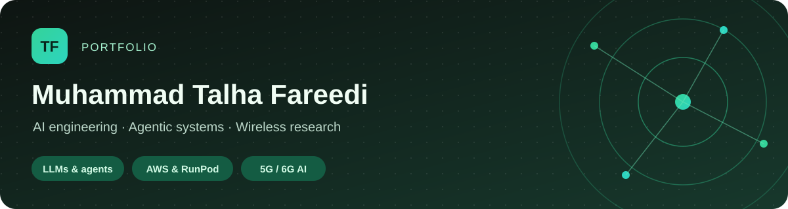
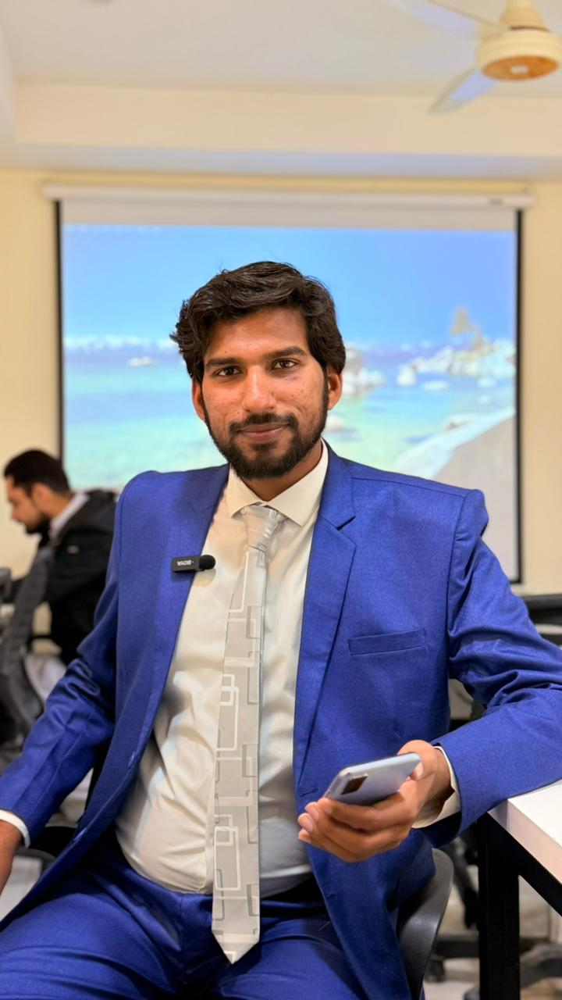
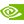

# Muhammad Talha Fareedi — Portfolio

  <a href="https://talhafaredi.github.io/Portfolio_webiste/"><strong>View the live portfolio</strong></a> ·
  <a href="https://github.com/TalhaFaredi">GitHub</a> ·
  <a href="https://www.linkedin.com/in/talha-fareedi/">LinkedIn</a> ·
  <a href="mailto:talhafareedi092@gmail.com">Email</a>

  

I am a machine learning engineer and M.S. student at Chung-Ang University. This portfolio covers my work in LLMs, agentic and multimodal systems, AI for wireless networks, and production deployments on AWS and RunPod.

## Explore the site

| Section | What you'll find |
| --- | --- |
| [AI and agents](https://talhafaredi.github.io/Portfolio_webiste/#ai) | Models, agent harnesses, coding agents, and evaluation charts |
| [Engineering stack](https://talhafaredi.github.io/Portfolio_webiste/#stack) | Cloud, model, data, API, and MLOps tools |
| [Wireless research](https://talhafaredi.github.io/Portfolio_webiste/#wireless) | ISAC, intelligent reflecting surfaces, and learning at the physical layer |
| [Projects](https://talhafaredi.github.io/Portfolio_webiste/#projects) | Voice AI, video tools, multi-model agents, computer vision, and more |
| [Publications](https://talhafaredi.github.io/Portfolio_webiste/#papers) | Research on prosthetic control, diabetes detection, and aerial object detection |

## Selected projects

- [Mellifon voice cloning](https://github.com/TalhaFaredi/Voice-clonner-Application)
- [SourceCut video editor](https://github.com/TalhaFaredi/Video-editing-Tool)
- [YouTube shorts generator](https://github.com/TalhaFaredi/Youtube-shorts-generation-)
- [Multi-model thinker](https://github.com/TalhaFaredi/Claude_Style_Multi_models_Thinker_Agent)

## Featured platforms

  &nbsp;&nbsp;
  &nbsp;&nbsp;
  &nbsp;&nbsp;
  &nbsp;&nbsp;
  

The website itself is a static, responsive site built with HTML, CSS, and JavaScript. It includes a light/dark theme toggle and mobile navigation. The icons above represent platforms and model providers featured in the portfolio.

## Run locally

Open `index.html` in a browser. No build step or dependencies are required.

**Live site:** [talhafaredi.github.io/Portfolio_webiste/](https://talhafaredi.github.io/Portfolio_webiste/)
